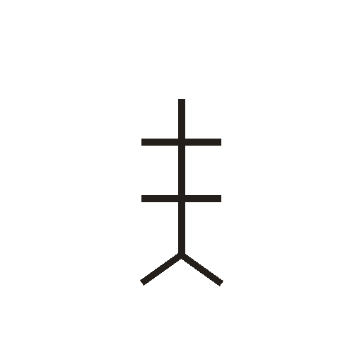
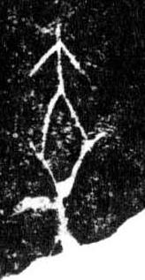

# 乘

> 人体动作类 · 商 · 难度 ★

| 甲骨形（示意） | 原拓片（真骨片） |
|:---:|:---:|
|  |  |

**今字**：乘

## 解析
甲骨文的「乘」是动作字，像人乘木之形。
这是「乘」之象——以人乘木为字，表示动作「乘」（乘坐、驾驭）。卜辞中「乘」常用作动作词。
后引申为「乘」等义。

## 出处
《甲骨文合集》乘字诸条（S1）；通行甲骨形见《甲骨文字典》「乘」部（S2）。

原拓片图：KLOBIP/OBIMD 甲骨文铭文多模态数据集（S6，CC-BY-4.0），主字 qhmhxv0zyb。
