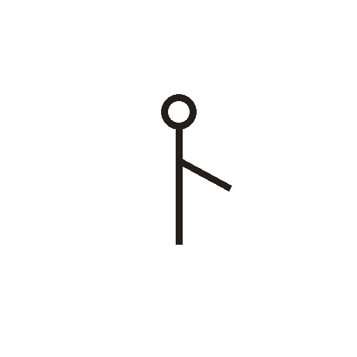

# 人

> 人体动作类 · 商 · 难度 ★

**甲骨形**：
**今字**：人

## 解析
甲骨文的「人」作侧立的一个人形：上有圆头，中为躯干，一臂前伸。
这是典型的象形字——以人的侧面轮廓为字，突出直立与一臂的姿态。
后来头被省略，躯干与手臂被规范成撇捺，至楷书定为「人」字。
「人」作偏旁时写作「亻」（单人旁），是同一象形的变形。
「仁」「休」（人倚树休息）、「众」（三人成众）等字从「人」得义。

## 出处
《甲骨文合集》人字诸条（S1）；通行甲骨形见《甲骨文字典》「人」部（S2）。
