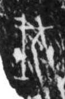

# 伐

> 人体动作类 · 商 · 难度 ★

| 甲骨形（示意） | 原拓片（真骨片） |
|:---:|:---:|
|  |  |

**今字**：伐

## 解析
甲骨文的「伐」是动作字，像人冠之形。
这是「伐」之象——以人冠为字，表示动作「伐」（砍伐、征伐）。卜辞中「伐」常用作动作词。
后引申为「伐」等义。

## 出处
《甲骨文合集》伐字诸条（S1）；通行甲骨形见《甲骨文字典》「伐」部（S2）。

原拓片图：KLOBIP/OBIMD 甲骨文铭文多模态数据集（S6，CC-BY-4.0），主字 zr3h63w2fy。
