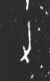

# 力

> 人体动作类 · 商 · 难度 ★

| 甲骨形（示意） | 原拓片（真骨片） |
|:---:|:---:|
|  |  |

**今字**：力

## 解析
甲骨文的「力」是耒耜之形（一竖加一横），像手执农具劳作之态。
这是「力」之象——以耒耜（劳作）之形为字。卜辞中「力」多指力量、力气（如「王用力」）。
后引申为「力量」「努力」「力学」等义。

## 出处
《甲骨文合集》力字诸条（S1）；通行甲骨形见《甲骨文字典》「力」部（S2）。

原拓片图：KLOBIP/OBIMD 甲骨文铭文多模态数据集（S6，CC-BY-4.0），主字 kh67ey65hl。
