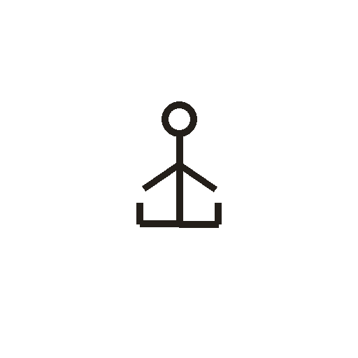

# 女

> 人体动作类 · 商 · 难度 ★★

**甲骨形**：
**今字**：女

## 解析
甲骨文的「女」是一个跪坐的人形：头、上身、双臂（一手抚胸）、跪坐的腿。这是典型的
象形字——以女子跪坐之形为字（古以跪坐为礼）。后来跪坐的腿简化，连笔成「女」字，
楷书定为「女」。女、如、妙、好、姐等字皆从「女」。注意：「女」的甲骨形是跪坐人，
与「人」（侧立）、「立」（站立）有别。

## 出处
《甲骨文合集》女字诸条（S1）；通行甲骨形见《甲骨文字典》「女」部（S2）。
