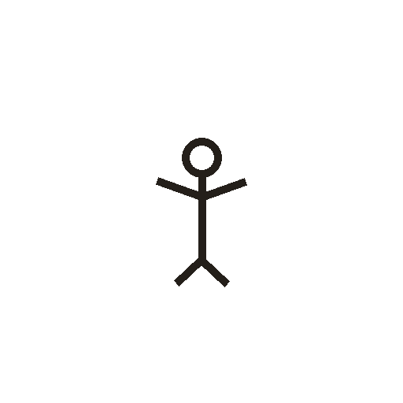

# 子

> 人体动作类 · 商 · 难度 ★★

**甲骨形**：
**今字**：子

## 解析
甲骨文的「子」是婴儿形：头、两臂上举（或张开）、身体。这是典型的象形字——
以婴儿（头大、臂张）为字。后来婴儿形简化，头与身连笔，楷书定为「子」。
子、字、学、孩、存等字皆从「子」。「子」本义是婴儿，后引申为儿女、子女，
又作尊称（孔子、老子）。

## 出处
《甲骨文合集》子字诸条（S1）；通行甲骨形见《甲骨文字典》「子」部（S2）。
