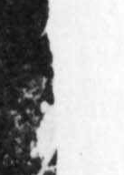

# 来

> 人体动作类 · 商 · 难度 ★

| 甲骨形（示意） | 原拓片（真骨片） |
|:---:|:---:|
|  |  |

**今字**：来

## 解析
甲骨文的「来」是动作字，像人冠之形。
这是「来」之象——以人冠为字，表示动作「来」（到来、来到）。卜辞中「来」常用作动作词。
后引申为「来」等义。

## 出处
《甲骨文合集》来字诸条（S1）；通行甲骨形见《甲骨文字典》「来」部（S2）。

原拓片图：KLOBIP/OBIMD 甲骨文铭文多模态数据集（S6，CC-BY-4.0），主字 ?。
