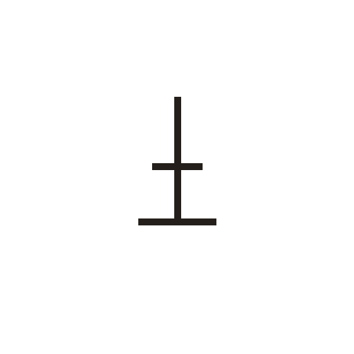
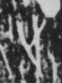

# 止

> 人体动作类 · 商 · 难度 ★

| 甲骨形（示意） | 原拓片（真骨片） |
|:---:|:---:|
|  |  |

**今字**：止

## 解析
甲骨文的「止」是足趾之形（一竖加底横、中一小横），像脚掌落地、停止之态。
这是「止」之象——以足趾之形为字。卜辞中「止」多指停止、到达（如「王至于某地」）。
后引申为「停止」「脚」「地支」等义，是「趾」「歧」「武」等字的声符。

## 出处
《甲骨文合集》止字诸条（S1）；通行甲骨形见《甲骨文字典》「止」部（S2）。

原拓片图：KLOBIP/OBIMD 甲骨文铭文多模态数据集（S6，CC-BY-4.0），主字 ch3eogm319。
