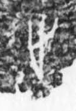

# 步

> 人体动作类 · 商 · 难度 ★

| 甲骨形（示意） | 原拓片（真骨片） |
|:---:|:---:|
|  |  |

**今字**：步

## 解析
甲骨文的「步」是两足前后相迈之形（两个足趾，一前一后），像行走迈步。
这是「步」之象——以两足迈步之形为字。卜辞中「步」多指行走、脚步（如「王步于某地」）。
后引申为「脚步」「步伐」「步骤」等义。

## 出处
《甲骨文合集》步字诸条（S1）；通行甲骨形见《甲骨文字典》「步」部（S2）。

原拓片图：KLOBIP/OBIMD 甲骨文铭文多模态数据集（S6，CC-BY-4.0），主字 6dnfyfs9ol。
