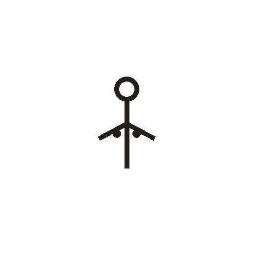

# 母

> 人体动作类 · 商 · 难度 ★★

**甲骨形**：
**今字**：母

## 解析
甲骨文的「母」是「女」字加两点（乳房），表示哺乳的母亲。这是会意字——
在「女」的基础上加乳房标志，点明「母」的养育之义。后来「女」形简化，
两点保留为「母」中的两点，楷书定为「母」。母、每、奶、嫡等字皆从「母」。
「母」与「女」的区别：母有乳房标志（哺乳），女无。

## 出处
《甲骨文合集》母字诸条（S1）；通行甲骨形见《甲骨文字典》「母」部（S2）。
