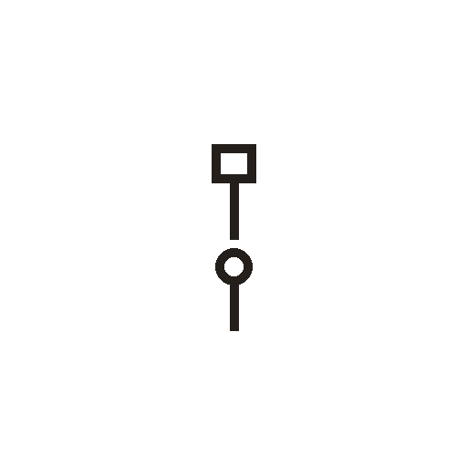

# 父

> 人体动作类 · 商 · 难度 ★★★

**甲骨形**：
**今字**：父

## 解析
甲骨文的「父」是手执物（斧、耒之类）立于儿（小孩）之上的形：上方一框是手执工具，
下方一个小孩（人形）。这是会意字——父亲是手持工具、有养育与劳作之力的人。
后来上部「父」形保留（手执物），下部「儿」省略，楷书定为「父」。父、爸、爷等字皆从「父」。

## 出处
《甲骨文合集》父字诸条（S1）；通行甲骨形见《甲骨文字典》「父」部（S2）。
