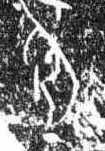

# 耳

> 人体动作类 · 商 · 难度 ★

| 甲骨形（示意） | 原拓片（真骨片） |
|:---:|:---:|
|  |  |

**今字**：耳

## 解析
甲骨文的「耳」是耳廓之形（一竖加一横、一短横），像耳朵。
这是「耳」之象——以耳廓之形为字。卜辞中「耳」多指耳朵（如「王有耳疾」）。
后引申为「耳朵」「耳目」「耳语」等义。

## 出处
《甲骨文合集》耳字诸条（S1）；通行甲骨形见《甲骨文字典》「耳」部（S2）。

原拓片图：KLOBIP/OBIMD 甲骨文铭文多模态数据集（S6，CC-BY-4.0），主字 32pzmjlrd9。
