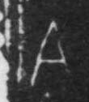

# 肉

> 人体动作类 · 商 · 难度 ★

| 甲骨形（示意） | 原拓片（真骨片） |
|:---:|:---:|
|  |  |

**今字**：肉

## 解析
甲骨文的「肉」是肉块之形（方块 + 一横），像肉。
这是「肉」之象——以肉块之形为字。卜辞中「肉」多指肉（如「王获鹿，取其肉」）。
后引申为「肉」「骨肉」「血肉」等义。

## 出处
《甲骨文合集》肉字诸条（S1）；通行甲骨形见《甲骨文字典》「肉」部（S2）。

原拓片图：KLOBIP/OBIMD 甲骨文铭文多模态数据集（S6，CC-BY-4.0），主字 yg0sm41ear。
