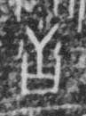

# 舌

> 人体动作类 · 商 · 难度 ★

| 甲骨形（示意） | 原拓片（真骨片） |
|:---:|:---:|
|  |  |

**今字**：舌

## 解析
甲骨文的「舌」是叉形舌（一竖加下叉），像舌头。
这是「舌」之象——以叉形舌之形为字。卜辞中「舌」多指舌头（如「王舌疾」）。
后引申为「舌头」「舌战」「口舌」等义。

## 出处
《甲骨文合集》舌字诸条（S1）；通行甲骨形见《甲骨文字典》「舌」部（S2）。

原拓片图：KLOBIP/OBIMD 甲骨文铭文多模态数据集（S6，CC-BY-4.0），主字 mrz7t6gxh0。
