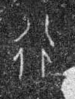

# 行

> 人体动作类 · 商 · 难度 ★

| 甲骨形（示意） | 原拓片（真骨片） |
|:---:|:---:|
|  |  |

**今字**：行

## 解析
甲骨文的「行」是十字路口之形（一竖一横交叉，旁有脚迹），像道路与行走。
这是道路、行走之象——以十字路口之形为字。卜辞中「行」多指行走、出行（如「王行」即王出行）。
后引申为「行走」「行为」「品行」「行业」等义。

## 出处
《甲骨文合集》行字诸条（S1）；通行甲骨形见《甲骨文字典》「行」部（S2）。

原拓片图：KLOBIP/OBIMD 甲骨文铭文多模态数据集（S6，CC-BY-4.0），主字 7es6m890l4。
