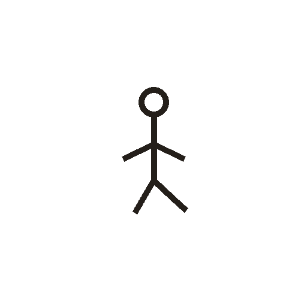
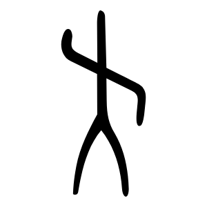

# 走

> 人体动作类 · 商 · 难度 ★★

| 甲骨形（示意） | 甲骨原形（参考图） |
|:---:|:---:|
|  |  |

**今字**：走

## 解析
甲骨文的「走」是一个人迈步（或奔跑）的侧形：头、上身、一前一后的腿（迈步行走）。
这是典型的象形字——以行走（奔跑）之形为字。注意：「走」在甲骨文中是「跑」的意思，
后来「跑」专用「走」，「走」又分化出「步行」之义。后来迈步的腿简化，楷书定为「走」。
走、起、越、趣等字皆从「走」。

## 出处
《甲骨文合集》走字诸条（S1）；通行甲骨形见《甲骨文字典》「走」部（S2）。

甲骨原形图：Wikimedia Commons「走-oracle.svg」（公版，CC-Zero，商甲骨风格）。
