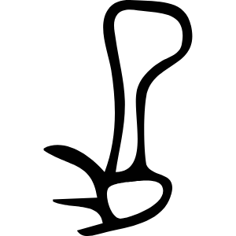

# 足

> 人体动作类 · 商 · 难度 ★★★

| 甲骨形（示意） | 甲骨原形（参考图） |
|:---:|:---:|
|  |  |

**今字**：足

## 解析
甲骨文的「足」是脚掌加脚趾形：下方一横（或矩形）是脚掌，上方几短竖是脚趾，
再上是小腿。这是典型的象形字——以足之形为字。后来足形简化，脚掌与脚趾连笔，
楷书定为「足」。足、路、践、距等字皆从「足」。注意：「足」本义是脚，后来引申为
「足够」（足、足以），又作量词。

## 出处
《甲骨文合集》足字诸条（S1）；通行甲骨形见《甲骨文字典》「足」部（S2）。

甲骨原形图：Wikimedia Commons「足-oracle.svg」（公版，CC-Zero，商甲骨风格）。
