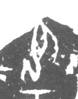

# 身

> 人体动作类 · 商 · 难度 ★

| 甲骨形（示意） | 原拓片（真骨片） |
|:---:|:---:|
|  |  |

**今字**：身

## 解析
甲骨文的「身」是身躯之形（一竖加两横），像身体。
这是「身」之象——以身躯之形为字。卜辞中「身」多指身体、自身（如「王身疾」）。
后引申为「身体」「自身」「身分」等义。

## 出处
《甲骨文合集》身字诸条（S1）；通行甲骨形见《甲骨文字典》「身」部（S2）。

原拓片图：KLOBIP/OBIMD 甲骨文铭文多模态数据集（S6，CC-BY-4.0），主字 0fjs8401bp。
