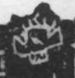

# 首

> 人体动作类 · 商 · 难度 ★

| 甲骨形（示意） | 原拓片（真骨片） |
|:---:|:---:|
|  |  |

**今字**：首

## 解析
甲骨文的「首」是戴冠之头（圆圈 + 一横、一短横），像头。
这是「首」之象——以戴冠之头之形为字。卜辞中「首」多指头（如「王首疾」）。
后引申为「头」「首先」「首领」等义。

## 出处
《甲骨文合集》首字诸条（S1）；通行甲骨形见《甲骨文字典》「首」部（S2）。

原拓片图：KLOBIP/OBIMD 甲骨文铭文多模态数据集（S6，CC-BY-4.0），主字 jupa4d7mu6。
