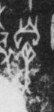

# 鼻

> 人体动作类 · 商 · 难度 ★

| 甲骨形（示意） | 原拓片（真骨片） |
|:---:|:---:|
|  |  |

**今字**：鼻

## 解析
甲骨文的「鼻」是手覆面（鼻子）之形（圆圈 + 一竖、一横），像鼻子。
这是「鼻」之象——以手覆面（鼻子）之形为字。卜辞中「鼻」多指鼻子（如「王鼻疾」）。
后引申为「鼻子」「鼻息」「鼻祖」等义。

## 出处
《甲骨文合集》鼻字诸条（S1）；通行甲骨形见《甲骨文字典》「鼻」部（S2）。

原拓片图：KLOBIP/OBIMD 甲骨文铭文多模态数据集（S6，CC-BY-4.0），主字 8kl4colp8e。
