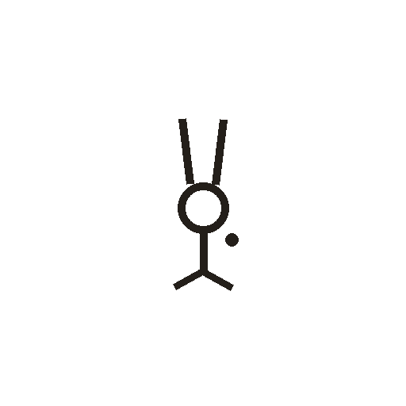
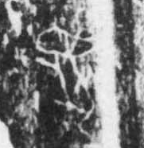

# 兔

> 动植物类 · 商 · 难度 ★★★

| 甲骨形（示意） | 原拓片（真骨片） |
|:---:|:---:|
|  |  |

**今字**：兔

## 解析
甲骨文的「兔」是兔的侧身形：头、长耳（两竖向上）、身、前腿和后腿。这是典型的
象形字——以兔的长耳与四足为字。后来兔形简化，长耳与身连笔，腿脚省略，
楷书定为「兔」。兔、免、冤等字皆从「兔」。注意：「兔」的甲骨形长耳突出，
与「走」「象」等字有别。

## 出处
《甲骨文合集》兔字诸条（S1）；通行甲骨形见《甲骨文字典》「兔」部（S2）。

原拓片图：KLOBIP/OBIMD 甲骨文铭文多模态数据集（S6，CC-BY-4.0），主字 exg6lsn5w7。