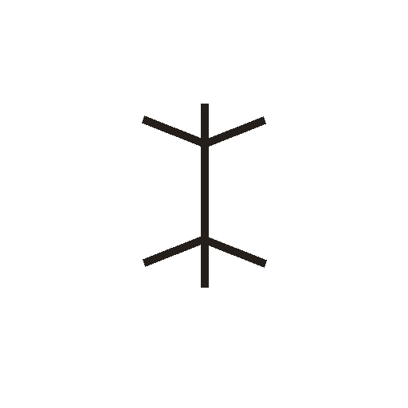

# 木

> 动植物类 · 商 · 难度 ★★

**甲骨形**：
**今字**：木

## 解析
甲骨文的「木」作一棵树形：中竖是树干，上端分枝是枝叶，下端分叉是树根。
这是典型的象形字——以整棵树的形态为字，上为枝、下为根，中间是主干。
后来枝根被规范成撇捺，至楷书定为「木」字。
「本」（树根处加点，指根本）、「末」（树梢处加点，指末端）、「林」（两木成林）
等字皆从「木」得义。

## 出处
《甲骨文合集》木字诸条（S1）；通行甲骨形见《甲骨文字典》「木」部（S2）。
