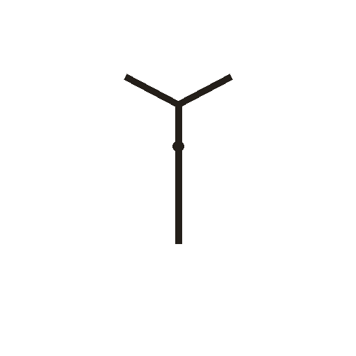
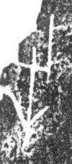

# 牛

> 动植物类 · 商 · 难度 ★★

| 甲骨形（示意） | 原拓片（真骨片） |
|:---:|:---:|
|  |  |

**今字**：牛

## 解析
甲骨文的「牛」作牛头正面形：中竖是鼻梁，上端分出的两支是左右牛角，
下端一点是鼻。这是典型的象形字——以牛头的正面轮廓为字，突出标志性的
弯曲牛角。后来牛头被抽象成横竖笔画，至楷书定为「牛」字。
「牧」（手持鞭放牛）、「物」（牛背上的花纹，引申为万物）等字从「牛」得义。

## 出处
《甲骨文合集》牛字诸条（S1）；通行甲骨形见《甲骨文字典》「牛」部（S2）。

原拓片图：KLOBIP/OBIMD 甲骨文铭文多模态数据集（S6，CC-BY-4.0），主字 66iowpdbuc。