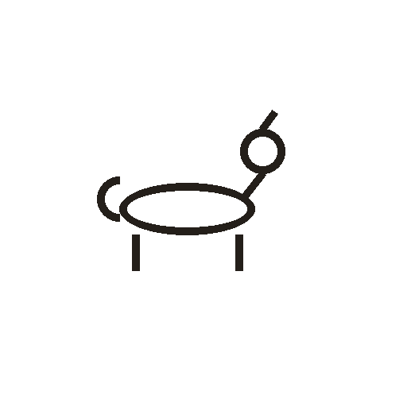
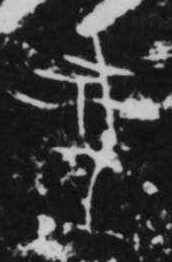

# 犬

> 动植物类 · 商 · 难度 ★★★

| 甲骨形（示意） | 原拓片（真骨片） |
|:---:|:---:|
|  |  |

**今字**：犬

## 解析
甲骨文的「犬」是犬的侧身形：头、颈、身、四足，尾巴卷起（区别于「狗」的直尾）。
这是典型的象形字——以犬的整体外形为字。后来犬形简化，头身连笔，尾省略，
楷书定为「犬」。犬、犭（反犬旁）等字皆从「犬」。注意：甲骨文中「犬」与「狗」
有区别，前者尾卷、后者尾直，后来合并。

## 出处
《甲骨文合集》犬字诸条（S1）；通行甲骨形见《甲骨文字典》「犬」部（S2）。

原拓片图：KLOBIP/OBIMD 甲骨文铭文多模态数据集（S6，CC-BY-4.0），主字 h9hoshfwwj。