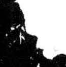

# 竹

> 动植物类 · 商 · 难度 ★★★

| 甲骨形（示意） | 原拓片（真骨片） |
|:---:|:---:|
|  |  |

**今字**：竹

## 解析
甲骨文的「竹」作两丛竹形：两根竹竿并立，竿上有节（节点），
竿头有竹叶下垂。这是典型的象形字——以竹丛的形态为字，突出竹竿与竹节。
后来两丛竹被规范成上下两个「个」形，至楷书定为「竹」字（「竹」字头）。
「竿」「笋」「筒」「筷」等与竹相关的字皆从「竹」得义。

## 出处
《甲骨文合集》竹字诸条（S1）；通行甲骨形见《甲骨文字典》「竹」部（S2）。

原拓片图：KLOBIP/OBIMD 甲骨文铭文多模态数据集（S6，CC-BY-4.0），主字 82z4h91v4r。