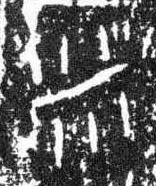

# 米

> 动植物类 · 商 · 难度 ★★

| 甲骨形（示意） | 原拓片（真骨片） |
|:---:|:---:|
|  |  |

**今字**：米

## 解析
甲骨文的「米」是散落的谷粒：中间一竖（或谷穗），两侧点线纷散是脱落的米粒。
这是典型的象形字——以散落的米粒为字。后来米粒简化，连笔成撇捺，楷书定为「米」。
米、粒、粉、糁等字皆从「米」。注意：「米」的甲骨形是谷粒散落，与「禾」（整株）
有别——禾是植株，米是脱粒后的谷。

## 出处
《甲骨文合集》米字诸条（S1）；通行甲骨形见《甲骨文字典》「米」部（S2）。

原拓片图：KLOBIP/OBIMD 甲骨文铭文多模态数据集（S6，CC-BY-4.0），主字 u5pens8hl2。