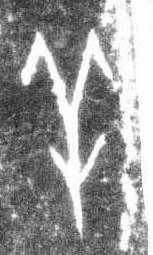

# 羊

> 动植物类 · 商 · 难度 ★★

| 甲骨形（示意） | 原拓片（真骨片） |
|:---:|:---:|
|  |  |

**今字**：羊

## 解析
甲骨文的「羊」是羊头正面形：一个圆圈是头，上面两根分叉向上的线条是羊角，
头下是脸。这是典型的象形字——以羊头（尤其是标志性的羊角）为字。后来
羊头简化，上部成「⺷」形，下部加「干」，楷书定为「羊」。羊、美、羞、群等字皆从「羊」。

## 出处
《甲骨文合集》羊字诸条（S1）；通行甲骨形见《甲骨文字典》「羊」部（S2）。

原拓片图：KLOBIP/OBIMD 甲骨文铭文多模态数据集（S6，CC-BY-4.0），主字 aoaipuy20h。