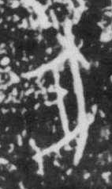

# 豕

> 动植物类 · 商 · 难度 ★★★

| 甲骨形（示意） | 原拓片（真骨片） |
|:---:|:---:|
|  |  |

**今字**：豕

## 解析
甲骨文的「豕」是猪的侧身形：圆身、短腿、头上一个短尾或耳。这是典型的象形字——
以猪的圆胖外形为字。后来豕形简化，身腿连笔，楷书定为「豕」。豕即猪，是
商代重要的家畜与祭祀牺牲。豕、家、彘、猪等字皆从「豕」。注意：「豕」与「猪」
同义，前者是古字。

## 出处
《甲骨文合集》豕字诸条（S1）；通行甲骨形见《甲骨文字典》「豕」部（S2）。

原拓片图：KLOBIP/OBIMD 甲骨文铭文多模态数据集（S6，CC-BY-4.0），主字 h920pdxci1。