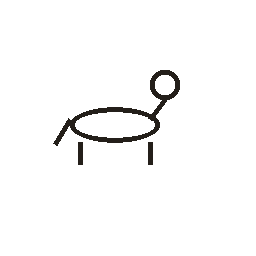

# 马

> 动植物类 · 商 · 难度 ★★★

**甲骨形**：
**今字**：马

## 解析
甲骨文的「马」作马的侧视形：上有头与鬃，中有长身，下有四足（常省两足），
尾下垂。这是典型的象形字——以马的侧面轮廓为字，突出鬃毛与修长的身形。
后来头、身、足逐渐抽象化，鬃毛与头被简化，至楷书定为「马」字。
「驰」「驾」「骏」等与马相关的字皆从「马」得声或得义。

## 出处
《甲骨文合集》马字诸条（S1）；通行甲骨形见《甲骨文字典》「马」部（S2）。
