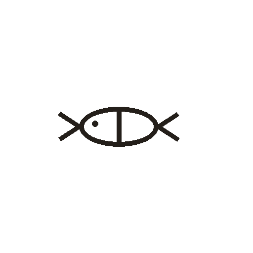

# 鱼

> 动植物类 · 商 · 难度 ★★

**甲骨形**：
**今字**：鱼

## 解析
甲骨文的「鱼」是鱼的整体形：尖头（口）、椭圆身、尾部分叉成两叉。这是典型的
象形字——以鱼的形体为字。后来鱼头、鱼身连笔，尾叉简化为两点，楷书定为「鱼」。
鱼、鲁、鲜、鲂等字皆从「鱼」。注意：「鱼」的甲骨形头尾分明，是水生动物之字。

## 出处
《甲骨文合集》鱼字诸条（S1）；通行甲骨形见《甲骨文字典》「鱼」部（S2）。
