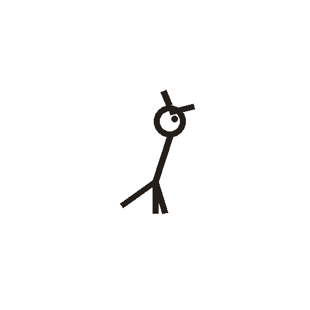

# 鸟

> 动植物类 · 商 · 难度 ★★

**甲骨形**：
**今字**：鸟

## 解析
甲骨文的「鸟」是鸟的侧身形：头上一冠、尖喙、身、尾、爪。这是典型的象形字——
以鸟的形体（尤其冠、喙、爪）为字。后来鸟形简化，头冠与身连笔，爪省略，
楷书定为「鸟」。鸟、乌、鸠、鸾等字皆从「鸟」。注意：「鸟」与「乌」有别，
前者有冠、后者无冠。

## 出处
《甲骨文合集》鸟字诸条（S1）；通行甲骨形见《甲骨文字典》「鸟」部（S2）。
