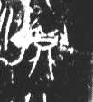

# 具

> 器物类 · 商 · 难度 ★

| 甲骨形（示意） | 原拓片（真骨片） |
|:---:|:---:|
|  |  |

**今字**：具

## 解析
甲骨文的「具」是名词字，像人冠之形。
这是「具」之象——以人冠为字，表示名词「具」（工具、器具）。卜辞中「具」常用作名词。
后引申为「具」等义。

## 出处
《甲骨文合集》具字诸条（S1）；通行甲骨形见《甲骨文字典》「具」部（S2）。

原拓片图：KLOBIP/OBIMD 甲骨文铭文多模态数据集（S6，CC-BY-4.0），主字 vgvqkrxgz3。
