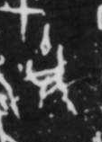

# 冑

> 器物类 · 商 · 难度 ★★★

| 甲骨形（示意） | 原拓片（真骨片） |
|:---:|:---:|
|  |  |

**今字**：冑

## 解析
甲骨文的「冑」是罕见字，像人冠之形。
这是「冑」之象——以人冠为字。卜辞中「冑」出现极少，具体含义待考。
后引申为「冑」等义。

## 出处
《甲骨文合集》冑字诸条（S1）；通行甲骨形见《甲骨文字典》「冑」部（S2）。

原拓片图：KLOBIP/OBIMD 甲骨文铭文多模态数据集（S6，CC-BY-4.0），主字 a8yk8tkxc4。
