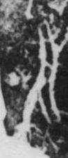

# 刃

> 器物类 · 商 · 难度 ★

| 甲骨形（示意） | 原拓片（真骨片） |
|:---:|:---:|
|  |  |

**今字**：刃

## 解析
甲骨文的「刃」是刀锋之形（一竖加一横），像刀刃。
这是「刃」之象——以刀锋之形为字。卜辞中「刃」多指刀刃、锋利（如「刃戈」）。
后引申为「刀刃」「锋利」「刀刃向里」等义。

## 出处
《甲骨文合集》刃字诸条（S1）；通行甲骨形见《甲骨文字典》「刃」部（S2）。

原拓片图：KLOBIP/OBIMD 甲骨文铭文多模态数据集（S6，CC-BY-4.0），主字 anku02zxgu。
