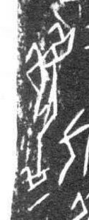

# 履

> 器物类 · 商 · 难度 ★

| 甲骨形（示意） | 原拓片（真骨片） |
|:---:|:---:|
|  |  |

**今字**：履

## 解析
甲骨文的「履」是鞋子之形（一竖加一横、两撇），像鞋。
这是「履」之象——以鞋子之形为字。卜辞中「履」多指鞋子、穿戴（如「王赐履」）。
后引申为「鞋子」「履历」「履行」等义。

## 出处
《甲骨文合集》履字诸条（S1）；通行甲骨形见《甲骨文字典》「履」部（S2）。

原拓片图：KLOBIP/OBIMD 甲骨文铭文多模态数据集（S6，CC-BY-4.0），主字 vaz8c6nubx。
