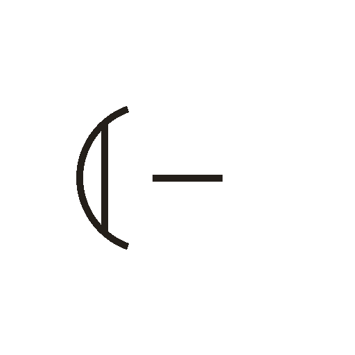

# 弓

> 器物类 · 商 · 难度 ★

**甲骨形**：
**今字**：弓

## 解析
甲骨文的「弓」是一张弓的形：弓身弯曲成 C 形，两端的弦（一竖）绷紧。这是典型的
象形字——以弓之形为字。后来弓身与弦连笔，楷书定为「弓」。弓、弋、弦、弧、弱等字皆从「弓」。
「弓」是狩猎与战争的重要工具。

## 出处
《甲骨文合集》弓字诸条（S1）；通行甲骨形见《甲骨文字典》「弓」部（S2）。
