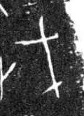

# 戈

> 器物类 · 商 · 难度 ★★★

| 甲骨形（示意） | 原拓片（真骨片） |
|:---:|:---:|
|  |  |

**今字**：戈

## 解析
甲骨文的「戈」是戟的形：一竖是柄，横出的刃是戈头，两端或下有小枝。这是典型的象形字——
以戈之形为字。后来戈头与柄连笔，楷书定为「戈」。戈、伐、戟、戋等字皆从「戈」。
「戈」是商代战争的主要兵器，与「兵」「器」相关。

## 出处
《甲骨文合集》戈字诸条（S1）；通行甲骨形见《甲骨文字典》「戈」部（S2）。

原拓片图：KLOBIP/OBIMD 甲骨文铭文多模态数据集（S6，CC-BY-4.0），主字 yunhitgxgx。