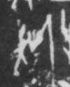

# 斧

> 器物类 · 商 · 难度 ★

| 甲骨形（示意） | 原拓片（真骨片） |
|:---:|:---:|
|  |  |

**今字**：斧

## 解析
甲骨文的「斧」是斧钺之形（一竖加一横），像斧头。
这是「斧」之象——以斧钺之形为字。卜辞中「斧」多指斧头、砍伐（如「王获斧」）。
后引申为「斧头」「金斧」「斧凿」等义。

## 出处
《甲骨文合集》斧字诸条（S1）；通行甲骨形见《甲骨文字典》「斧」部（S2）。

原拓片图：KLOBIP/OBIMD 甲骨文铭文多模态数据集（S6，CC-BY-4.0），主字 85y9jx9o86。
