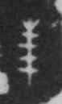

# 玉

> 器物类 · 商 · 难度 ★★

| 甲骨形（示意） | 原拓片（真骨片） |
|:---:|:---:|
|  |  |

**今字**：玉

## 解析
甲骨文的「玉」是一串玉的形：一根贯绳，串着三片玉（圆/菱形玉片）。典型的象形字——
以串玉之形直接为字，突出玉片成串的贵重。后来三片玉连缀，加「王」为声，楷书定为
「玉」字。玉、王、玖、珉等字皆从「玉」。注意与「王」（玉下加一横）有别。

## 出处
《甲骨文合集》玉字诸条（S1）；通行甲骨形见《甲骨文字典》「玉」部（S2）。

原拓片图：KLOBIP/OBIMD 甲骨文铭文多模态数据集（S6，CC-BY-4.0），主字 kam577w6oq。
