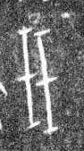

# 珏

> 器物类 · 商 · 难度 ★★

| 甲骨形（示意） | 原拓片（真骨片） |
|:---:|:---:|
|  |  |

**今字**：珏

## 解析
甲骨文的「珏」是双玉之形（两竖加两横），像两块玉相连。
这是「珏」之象——以双玉之形为字。卜辞中「珏」多指珏玉、祭祀（如「王赐珏」）。
后引申为「珏玉」「双玉」「珏璧」等义。

## 出处
《甲骨文合集》珏字诸条（S1）；通行甲骨形见《甲骨文字典》「珏」部（S2）。

原拓片图：KLOBIP/OBIMD 甲骨文铭文多模态数据集（S6，CC-BY-4.0），主字 goxg9wwonn。
