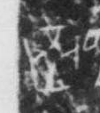

# 琮

> 器物类 · 商 · 难度 ★

| 甲骨形（示意） | 原拓片（真骨片） |
|:---:|:---:|
|  |  |

**今字**：琮

## 解析
甲骨文的「琮」是玉琮之形（方块加圆圈），像琮玉。
这是「琮」之象——以玉琮之形为字。卜辞中「琮」多指玉琮、祭祀（如「王赐琮」）。
后引申为「玉琮」「琮玉」「琮璧」等义。

## 出处
《甲骨文合集》琮字诸条（S1）；通行甲骨形见《甲骨文字典》「琮」部（S2）。

原拓片图：KLOBIP/OBIMD 甲骨文铭文多模态数据集（S6，CC-BY-4.0），主字 bfwtwd92m1。
