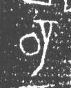

# 璧

> 器物类 · 商 · 难度 ★

| 甲骨形（示意） | 原拓片（真骨片） |
|:---:|:---:|
|  |  |

**今字**：璧

## 解析
甲骨文的「璧」是玉璧之形（两个同心圆），像璧玉。
这是「璧」之象——以玉璧之形为字。卜辞中「璧」多指玉璧、祭祀（如「王赐璧」）。
后引申为「玉璧」「璧玉」「完璧归赵」等义。

## 出处
《甲骨文合集》璧字诸条（S1）；通行甲骨形见《甲骨文字典》「璧」部（S2）。

原拓片图：KLOBIP/OBIMD 甲骨文铭文多模态数据集（S6，CC-BY-4.0），主字 tnwvrq73qx。
