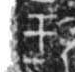

# 甲

> 器物类 · 商 · 难度 ★

| 甲骨形（示意） | 原拓片（真骨片） |
|:---:|:---:|
|  |  |

**今字**：甲

## 解析
甲骨文的「甲」是网格（方块加十字），像铠甲。
这是「甲」之象——以网格（铠甲）之形为字。卜辞中「甲」多指铠甲、第一（如「王穿甲」）。
后引申为「铠甲」「甲胄」「甲第」「甲等」等义。

## 出处
《甲骨文合集》甲字诸条（S1）；通行甲骨形见《甲骨文字典》「甲」部（S2）。

原拓片图：KLOBIP/OBIMD 甲骨文铭文多模态数据集（S6，CC-BY-4.0），主字 a1lmo1xxj5。
