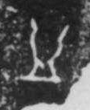

# 皿

> 器物类 · 商 · 难度 ★

| 甲骨形（示意） | 原拓片（真骨片） |
|:---:|:---:|
|  |  |

**今字**：皿

## 解析
甲骨文的「皿」是一个宽口的容器形：口沿外侈、下方有足。这是典型的象形字——
以器皿之形为字。后来皿形简化，口沿与器身连笔，楷书定为「皿」。皿、益、盏、监、
益等字皆从「皿」。「皿」本义是器皿，后专指碗盘之类。

## 出处
《甲骨文合集》皿字诸条（S1）；通行甲骨形见《甲骨文字典》「皿」部（S2）。

原拓片图：KLOBIP/OBIMD 甲骨文铭文多模态数据集（S6，CC-BY-4.0），主字 51p2xxpvps。