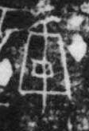

# 盾

> 器物类 · 商 · 难度 ★

| 甲骨形（示意） | 原拓片（真骨片） |
|:---:|:---:|
|  |  |

**今字**：盾

## 解析
甲骨文的「盾」是盾形（方块加一横），像盾牌。
这是「盾」之象——以盾形之形为字。卜辞中「盾」多指盾牌、防御（如「王持盾」）。
后引申为「盾牌」「后盾」「盾构」等义。

## 出处
《甲骨文合集》盾字诸条（S1）；通行甲骨形见《甲骨文字典》「盾」部（S2）。

原拓片图：KLOBIP/OBIMD 甲骨文铭文多模态数据集（S6，CC-BY-4.0），主字 0h1vf0twxr。
