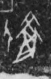

# 衣

> 器物类 · 商 · 难度 ★

| 甲骨形（示意） | 原拓片（真骨片） |
|:---:|:---:|
|  |  |

**今字**：衣

## 解析
甲骨文的「衣」是衣服之形（一竖加一横、两撇），像上衣。
这是「衣」之象——以衣服之形为字。卜辞中「衣」多指衣服、穿戴（如「王赐衣」）。
后引申为「衣服」「衣裳」「衣食」等义。

## 出处
《甲骨文合集》衣字诸条（S1）；通行甲骨形见《甲骨文字典》「衣」部（S2）。

原拓片图：KLOBIP/OBIMD 甲骨文铭文多模态数据集（S6，CC-BY-4.0），主字 ggmxiphq64。
