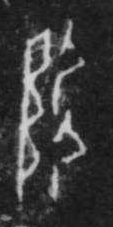

# 陶

> 器物类 · 商 · 难度 ★

| 甲骨形（示意） | 原拓片（真骨片） |
|:---:|:---:|
|  |  |

**今字**：陶

## 解析
甲骨文的「陶」是制陶之形（一竖加一横、一横），像陶器。
这是「陶」之象——以制陶之形为字。卜辞中「陶」多指陶器、陶工（如「王赐陶」）。
后引申为「陶器」「陶工」「陶醉」等义。

## 出处
《甲骨文合集》陶字诸条（S1）；通行甲骨形见《甲骨文字典》「陶」部（S2）。

原拓片图：KLOBIP/OBIMD 甲骨文铭文多模态数据集（S6，CC-BY-4.0），主字 du1603bntk。
