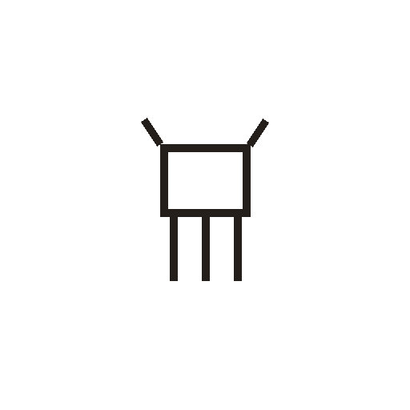

# 鼎

> 器物类 · 商 · 难度 ★★

**甲骨形**：
**今字**：鼎

## 解析
甲骨文的「鼎」是三足鼎的形：上方器身（矩形），两侧双耳（短竖），下方三足。这是典型的
象形字——以鼎之形为字。后来鼎形简化，器身与足连笔，楷书定为「鼎」。鼎、鼐、鼒等字皆从「鼎」。
「鼎」是商代重要的礼器与祭器，象征权力（问鼎、鼎革）。

## 出处
《甲骨文合集》鼎字诸条（S1）；通行甲骨形见《甲骨文字典》「鼎」部（S2）。
