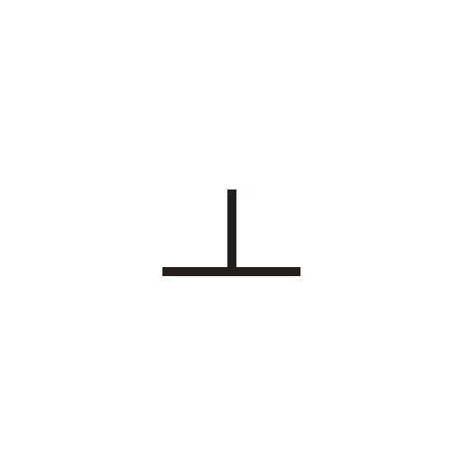

# 上

> 抽象类 · 商 · 难度 ★

**甲骨形**：
**今字**：上

## 解析
甲骨文的「上」是一横（基准线）上方一小竖（或点），表示「在上面」。这是会意字——
在一横之上加标记，表示方位「上」。后来上字不变，楷书定为「上」。上、丄、尚、
常、乘等字与「上」相关。「上」与「下」相对，是最基本的方位词。

## 出处
《甲骨文合集》上字诸条（S1）；通行甲骨形见《甲骨文字典》「上」部（S2）。
