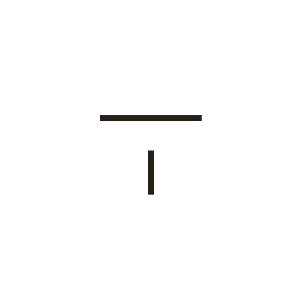
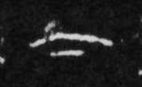

# 下

> 抽象类 · 商 · 难度 ★

| 甲骨形（示意） | 原拓片（真骨片） |
|:---:|:---:|
|  |  |

**今字**：下

## 解析
甲骨文的「下」是一横（基准线）下方一小竖（或点），表示「在下面」。这是会意字——
在一横之下加标记，表示方位「下」。后来下字不变，楷书定为「下」。下、下、
不、六等字与「下」相关。「下」与「上」相对，是最基本的方位词。

## 出处
《甲骨文合集》下字诸条（S1）；通行甲骨形见《甲骨文字典》「下」部（S2）。

原拓片图：KLOBIP/OBIMD 甲骨文铭文多模态数据集（S6，CC-BY-4.0），主字 zz00qbgu3m。